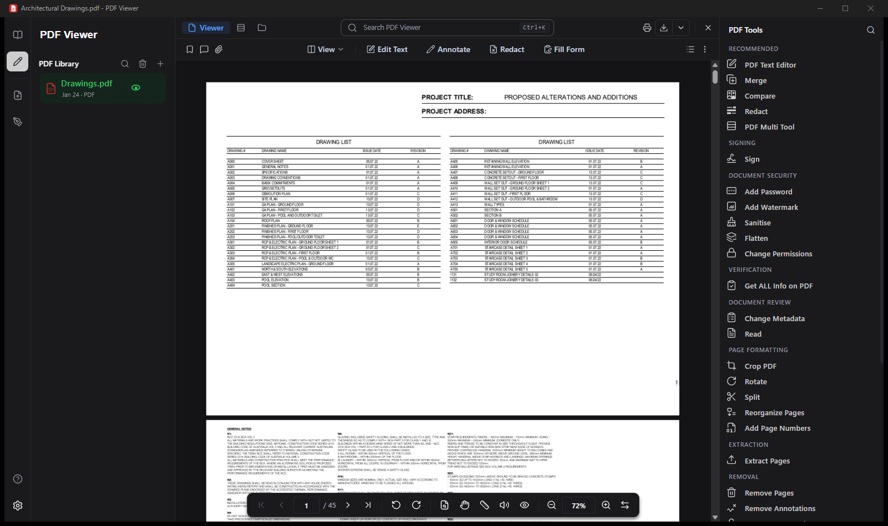
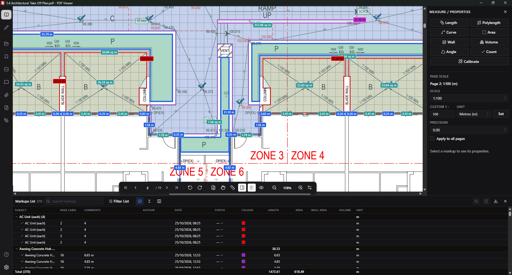

# PDF Viewer

**A fast, free and open-source PDF markup and editing studio for Windows.**

Read, mark up, organise and protect PDFs in one lightweight desktop app. No account, no subscription, no cloud: your files never leave your machine.





> **Early but usable.** Version 0.1. The viewer, markup and page tools work today; the professional markup, measurement and editing features below are on the [roadmap](docs/ROADMAP.md).

## Why PDF Viewer

Professionals who work with drawings and documents usually pay for two tools: **Bluebeam Revu** to mark up and measure, and **Adobe Acrobat Pro** to edit and manage PDFs. PDF Viewer is building towards both in a single free app, with the quick, keyboard-first feel of a professional markup tool.

The first big goal is **Revu-compatible review for everyone without a Revu licence**. Bluebeam no longer offers a free viewer, so subcontractors, clients and consultants who receive marked-up drawing sets cannot see Revu's statuses, custom columns or measurements, or answer them. PDF Viewer will.

PDF Viewer starts from the [Stirling-PDF](https://github.com/Stirling-Tools/Stirling-PDF) editor UI (MIT) and reshapes it into a desktop app: the Java backend, Docker setup and server-only tools are gone, and the tools that needed a server are being re-written to run inside the app.

## Where PDF Viewer is different

- **Free and open source.** No subscription, no feature tiers, no trial, no watermark. Anyone can read the code, fork it or extend it.
- **No account, nothing online.** No sign-in, no licence check, no telemetry, no cloud or AI service. Your files never leave your PC, which suits confidential drawings and air-gapped networks.
- **Installs without admin rights.** The installer is per-user, so it works on locked-down company laptops where IT has to install Revu or Acrobat for you.
- **Page orders the others don't do.** Booklet and side-stitch order, interleaving separately scanned front and back pages, odd/even splits and other page-reordering modes, built in.
- **Light and quick.** One small native app with no Java and no server: a document is on screen in about half a second, zoom never flashes, and Ctrl+S saves straight back to the file.
- **Revu markups without Revu.** Bluebeam measurements open as measurements; status, custom columns and replies are next ([roadmap P2](docs/ROADMAP.md#phases)).

## What you can do today

- **Read**: smooth zoom and scroll, thumbnails, bookmarks, attachments and comments panels, find and replace text.
- **Measure** like Bluebeam: set the page scale by drawing a known length, then measure length, polylength, curve, area, wall, volume, angle and count. Values are written the way Revu writes them, so Revu and this app read each other's measurements. The Measure panel and the Markups List (with totals and CSV export) open from the left rail.
- **Mark up**: highlight, underline, strikeout, squiggly, pen and highlighter, text boxes, sticky notes, insert and replace text, rectangles, ellipses, lines, arrows, polylines, polygons, stamps, images and signatures.
- **Organise pages**: drag-and-drop page editor, merge, split, rotate, extract, delete, reorganise, crop.
- **Edit and annotate documents**: edit text, fill forms, watermark, page numbers, metadata, adjust colours, compare two documents.
- **Protect**: passwords and permissions, manual redaction, sanitise (scripts, embedded files, metadata), flatten.

## How it compares

| Feature | PDF Viewer | Bluebeam Revu | Acrobat Pro |
| --- | :---: | :---: | :---: |
| **Price** | Free | Paid subscription | Paid subscription |
| **Platforms** | Windows | Windows, plus web and iPad | Windows, macOS, web, mobile |
| _Freedom and footprint_ | | | |
| Open source | ✅ | ❌ | ❌ |
| No account or sign-in | ✅ | ❌ | ❌ |
| Works fully offline, no licence check or cloud features | ✅ | 🟡 | 🟡 |
| Installs without admin rights | ✅ | ❌ | ❌ |
| Booklet, side-stitch and duplex-scan page reordering | ✅ | ❌ | 🟡 |
| Review Revu markups (status, columns, measurements) without a Revu licence | 🟡 | ❌ | 🟡 |
| _Viewing_ | | | |
| Fast viewer, thumbnails, bookmarks, text search | ✅ | ✅ | ✅ |
| Search across files with bulk markup from results | 🗺️ | ✅ | 🟡 |
| Visual (symbol) search | 🗺️ | ✅ | ❌ |
| _Markup_ | | | |
| Text markup, pen, notes, shapes, stamps, signatures | ✅ | ✅ | ✅ |
| Text boxes and proofreading marks | ✅ | ✅ | ✅ |
| Callouts, clouds and Cloud+ | 🗺️ | ✅ | 🟡 |
| Tool Chest of reusable markup tools | 🗺️ | ✅ | ❌ |
| Live properties panel and single-key tool shortcuts | 🗺️ | ✅ | 🟡 |
| Layers and legends | 🗺️ | ✅ | 🟡 |
| Markups List with status, custom columns and CSV/XLSX export | 🟡 | ✅ | 🟡 |
| _Measurement_ | | | |
| Calibrated length, perimeter and area | ✅ | ✅ | 🟡 |
| Count, volume, cutouts and quantity totals | 🟡 | ✅ | ❌ |
| _Review_ | | | |
| Compare documents | ✅ | ✅ | ✅ |
| Overlay pages | 🗺️ | ✅ | ❌ |
| Import and export comments (XFDF/FDF) | 🗺️ | ✅ | ✅ |
| Real-time cloud collaboration | ➖ | ✅ | ✅ |
| _Pages and editing_ | | | |
| Merge, split, reorder, rotate, extract, crop | ✅ | ✅ | ✅ |
| Watermark and page numbers | ✅ | ✅ | ✅ |
| Headers, footers and Bates numbering | 🗺️ | 🟡 | ✅ |
| Edit existing text and images | 🟡 | 🟡 | ✅ |
| Fill forms | ✅ | ✅ | ✅ |
| Create form fields | 🗺️ | ✅ | ✅ |
| OCR scanned documents | 🗺️ | ✅ | ✅ |
| Compress and optimise | 🗺️ | ✅ | ✅ |
| Office to PDF and PDF to Word | 🗺️ | 🟡 | ✅ |
| _Security_ | | | |
| Passwords and permissions | ✅ | ✅ | ✅ |
| Redaction | 🟡 | ✅ | ✅ |
| Certificate digital signatures | 🗺️ | ✅ | ✅ |

✅ available · 🟡 partial · 🗺️ on our [roadmap](docs/ROADMAP.md) · ❌ not offered · ➖ not planned (needs a server)

Competitor columns reflect Bluebeam Revu 21 (Complete) and Adobe Acrobat Pro as publicly described in late 2026; check the vendors' sites for current details. Acrobat's 🟡 for page reordering is booklet printing only, and for Revu markups it is Acrobat showing them as ordinary comments. PDF Viewer is not affiliated with Bluebeam or Adobe, and their names are trademarks of their owners.

## Roadmap

| Phase | Theme | Highlights |
| --- | --- | --- |
| **P1** | Snappy desktop core | Any Windows font and non-Latin text, Bluebeam-style search panel, single-key tools, file switcher, print, file association |
| **P2** | Revu-compatible review | Read and reply to Bluebeam markups, Markups List with status, custom columns and totals, Revu measurement values, CSV/XLSX summaries, XFDF review |
| **P3** | Markup Studio | Tool Chest, properties panel, rich text and callouts, clouds and Cloud+, dimension lines, custom stamps, layers, overlay |
| **P4** | Measurement and takeoff | Calibration, length, area, volume, count, cutouts, snapping, quantity export |
| **P5** | Acrobat-class editing | Inline text and image editing, Organize Pages, headers and Bates, forms, OCR, compress, Office conversion |
| **P6** | Trust and scale | Certificate signing, PDF/A, accessibility, document sets, Visual Search |

The full feature-by-feature map is in [docs/ROADMAP.md](docs/ROADMAP.md); day-to-day status is in [docs/IMPLEMENTATION-PLAN.md](docs/IMPLEMENTATION-PLAN.md).

## Install

> No release is published yet: the first one is on its way. Until then, build the installer yourself as described under [Build from source](#build-from-source).

1. Download the latest `PDF Viewer_<version>_x64_en-US.msi` from the [Releases page](https://github.com/emibanana/PDF-Viewer/releases).
2. Double-click it. It installs for your Windows user only, so no admin rights are needed.
3. Start **PDF Viewer** from the Start menu, or right-click a PDF and choose **Open with**.

Needs Windows 10 or 11 (64-bit) with the Microsoft Edge WebView2 runtime, which Windows 11 and up-to-date Windows 10 already have.

The installer is not code-signed yet, so Windows SmartScreen may warn you the first time. Choose **More info**, then **Run anyway**.

## For contributors

### Build from source

You need:

- Node.js 20 or newer (with npm)
- Rust, installed with [rustup](https://rustup.rs) (stable, MSVC target)
- Microsoft C++ build tools, either of:
  - Visual Studio Build Tools with the "Desktop development with C++" workload, or
  - the per-user [portable-msvc](https://gist.github.com/mmozeiko/7f3162ec2988e81e56d5c4e22cde9977) in `%USERPROFILE%\tools\msvc`
- PowerShell (not Git Bash: its GNU `link` shadows the MSVC linker)

To build the installer and install it in one step, double-click **`Build and Install.cmd`** at the repo root. It writes a per-user MSI to `frontend/src-tauri/target/release/bundle/msi/` and launches it.

To run the app while developing, from `frontend/`:

```powershell
npm ci
npx tauri dev
```

- Keep the npm `@tauri-apps/*` packages on the same major/minor as the Rust `tauri` crates.
- Avoid a blanket `cargo update`; it can pull in duplicate `webview2-com-sys` versions that break the build.

### Checks and tools

| Command (from `frontend/`) | What it does |
| --- | --- |
| `npx tsc --noEmit -p tsconfig.studio.vite.json` | Typecheck the app |
| `npx oxlint --config oxlint.config.ts --max-warnings=0` | Lint |
| `npx vitest run --project core --project studio` | Unit tests |
| `cargo test` (in `frontend/src-tauri`) | Rust host tests |
| `python scripts/studio/gen-brand.py` | Regenerate every logo and icon from `studio/assets/brand/mark.svg` |
| `node scripts/studio/rebrand-locales.mjs` | Re-apply the product name to the locale files |

| Path | What |
| --- | --- |
| `frontend/src/editor/studio/` | Our UI layer. A file here with the same path as one in `core/` replaces it in our build |
| `frontend/src-tauri/` | Rust host: window, file open and save, single instance, Windows fonts |
| `frontend/scripts/studio/` | Brand and locale tooling |
| `frontend/src/editor/core/` | Upstream editor UI (MIT). Our edits here are kept small and logged in [docs/core-patches.md](docs/core-patches.md) |

Start with [AGENTS.md](AGENTS.md) and [docs/developer/FORK-FRONTEND-MAP.md](docs/developer/FORK-FRONTEND-MAP.md) for how the layers fit together. `main` is the product branch; the `upstream` remote is Stirling-Tools/Stirling-PDF, merged in when wanted.

## Licence

PDF Viewer is MIT licensed. The upstream directories `frontend/src/editor/{desktop,proprietary,cloud,saas}` and `frontend/src/processor` carry the restrictive Stirling PDF User License; this product never uses code from them, and the build fails if it tries to.
